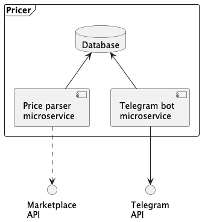

# Pricer system

Microservice system for parsing prices of marketplaces. System consists of next microservices:

[Parser service](https://github.com/sv-sand/pricer-parser-service)

[](https://github.com/sv-sand/pricer-parser-service/actions/workflows/maven.yml)
[](https://sonarcloud.io/summary/new_code?id=sv-sand_pricer-parser-service)
[](https://sonarcloud.io/summary/new_code?id=sv-sand_pricer-parser-service)
[](https://sonarcloud.io/summary/new_code?id=sv-sand_pricer-parser-service)

[Telegram bot service](https://github.com/sv-sand/pricer-tgbot)

[](https://github.com/sv-sand/pricer-tgbot/actions/workflows/maven.yml)
[](https://sonarcloud.io/summary/new_code?id=sv-sand_pricer-tgbot)
[](https://sonarcloud.io/summary/new_code?id=sv-sand_pricer-tgbot)
[](https://sonarcloud.io/summary/new_code?id=sv-sand_pricer-tgbot)

## System requirements

- Java 17
- Git
- Docker compose
- Maven

## Features

There is marketplaces supported now:
- Wildberries

### Scheme of system



## How to install

1. Install all required applications
2. Register new Telegram bot
3. Set environment variables:
```bash
export DB_HOST=pricer-db
export DB_USER=postgres
export DB_PASSWORD=postgres
export TGBOT_PRICER_TOKEN=your_token
```
4. Clone repository
```bash
cd /opt
git clone --recurse-submodules https://github.com/sv-sand/pricer.git
```
5. Build all services and run it into docker-compose:
```bash
sh ./build.sh
```

## How to update new deploy

Pull updates from repository and build containers:
```bash
git pull
sh ./build.sh
```